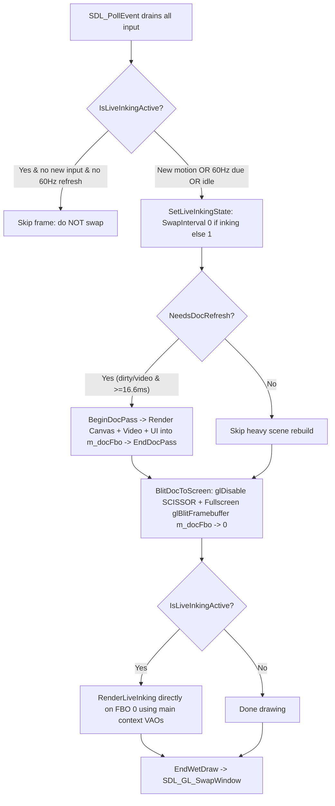

# Folio-Backends: Hardware Scanout, Presenters & Shaders (Tier 2)

## Architectural Scope & Decoupling Guarantees

`Folio-Backends` (`namespace Folio::Backends`, target `folio_backends`) is the **Tier 2** hardware rendering and presentation layer of Folio-Sketch. It bridges pure mathematical stroke data produced by Tier 1 (`folio_sketch`) into sub-millisecond / sub-2ms display output across **Linux, Windows, macOS, Android, and iOS**.

> [!IMPORTANT]
> **`folio_backends` has ZERO dependency on `inspectorV2.0/`**:
> Host applications (such as **FolioNote**) can delete `inspectorV2.0/` completely and build directly against `folio_sketch` + `folio_backends`. All platform presentation, FBO blitting, shader pipelines, and Android JNI routing live inside `folio_backends/`.

### Directory Layout

```text
folio_backends/
├── CMakeLists.txt                       # Builds static library 'folio_backends' (links folio_sketch)
├── common/
│   ├── surface_presenter.hpp            # Unified ISurfacePresenter interface & BackendPlatform enum
│   ├── display_surface_transform.hpp/.cpp # Desktop vs Android hardware rotation & scissor mapping
│   ├── gl_capsule_renderer.hpp/.cpp     # OpenGL 3.3 / GLES 3.0 Analytic Capsule SDF renderer
│   └── gl_raster_dab_renderer.hpp/.cpp  # OpenGL 3.3 / GLES 3.0 Pro Raster Dab / Paint renderer
├── desktop/
│   └── desktop_presenter.hpp/.cpp       # Desktop (Linux & Windows) OpenGL 3.3 + Decoupled docFbo pipeline
├── sdl_gpu/
│   ├── capsule_shaders_spv.hpp          # Pre-compiled SPIR-V Capsule SDF vertex & fragment shaders
│   └── sdl_gpu_presenter.hpp/.cpp       # SDL3 GPU (Vulkan / D3D12 / Metal) < 1 ms presenter
├── android/
│   ├── android_frontbuffer.hpp/.cpp     # AndroidFrontBuffer + AndroidHostCallbacks bridge
│   └── folio_android_jni.cpp            # JNI bridge (Java GLFrontBufferedRenderer <-> C++ host)
└── ios/
    └── ios_presenter.hpp/.cpp           # Apple iOS / iPadOS Metal CAMetalLayer scaffold
```

---

## 1. Unified Surface Presentation (`ISurfacePresenter`)

OS compositors (Wayland Mutter, Windows DWM, Android SurfaceFlinger) introduce **16 ms – 48 ms** of input-to-photon latency when driven by naive 60/120 Hz triple-buffered swap loops. `ISurfacePresenter` (`folio_backends/common/surface_presenter.hpp`) unifies platform bypass mechanisms behind one interface:

| Platform | Implementation | Graphics API | Low-Latency Mechanism | Target Latency |
| :--- | :--- | :--- | :--- | :--- |
| **Desktop (Linux / Windows)** | `DesktopPresenter` | OpenGL 3.3 + SDL3 | Decoupled fullscreen `m_docFbo` blit + demand-driven `SwapInterval(0)` | `< 1–2 ms` |
| **Desktop Universal GPU** | `SdlGpuPresenter` | SDL3 GPU (Vulkan / D3D12 / Metal) | `SDL_GPU_PRESENTMODE_MAILBOX` / `IMMEDIATE` + instanced transfer buffer | `< 1 ms` |
| **Android** | `AndroidFrontBuffer` + JNI | GLES 3.0 + Jetpack `GLFrontBufferedRenderer` | Direct DPU hardware front-buffer scanout + `glFlush()` + scissored FBO | `< 2 ms` |
| **iOS / iPadOS** | `IosPresenter` | Metal (`CAMetalLayer`) | Direct drawable commit + 240 Hz Apple Pencil | `< 4 ms` |

---

## 2. Desktop OpenGL Zero-Latency Pipeline (`DesktopPresenter`)

Desktop windowing systems (especially Wayland GNOME Mutter and Windows DWM) enforce strict physical constraints on OpenGL 3.3 contexts. `DesktopPresenter` encapsulates a **Decoupled Fullscreen `m_docFbo` Blit Pipeline** tuned around those constraints.

### Why Naive Approaches Fail on Desktop OpenGL
1. **Do NOT use `glFlush()` alone on a double-buffered window (`SDL_GL_DOUBLEBUFFER = 1`)**: Rendering to the back buffer without `SDL_GL_SwapWindow` leaves live strokes invisible until pen-up.
2. **Do NOT use `glScissor` during wet-ink blits on double-buffered windows**: Swapping alternates between two back buffers; scissoring leaves everything outside the pen box uninitialized/black, causing severe flashing.
3. **Do NOT create a second `SDL_GLContext` for a transparent overlay**: In OpenGL 3.3 Core, **VAOs cannot be shared across contexts**. Drawing `GlCapsuleRenderer` VAOs in a second context causes a segmentation fault.
4. **Do NOT spin `SDL_GL_SwapWindow()` in an empty loop**: Even with `SDL_GL_SetSwapInterval(0)`, spinning at ~0.2 ms/frame fills the 3-buffer Wayland/DWM swapchain in `< 1 ms`, causing frame 4 to stall inside `SDL_GL_SwapWindow()` for `~8.33 ms` (blocking input polling).

### The Working Desktop Flow



### Key `DesktopPresenter` APIs

- **`SetLiveInkingState(bool isLiveInking)`**: Switches `SDL_GL_SetSwapInterval(0)` on pen/mouse-down and restores `SDL_GL_SetSwapInterval(1)` on pen/mouse-up (only calling SDL on state transitions).
- **`NeedsDocRefresh(docDirty, uiDirty, hasActiveVideo, isLiveInking, refreshIntervalMs = 16.6)`**:
  - Guarantees the background document, Dear ImGui UI, and active video textures still refresh at **60 Hz (`16.6 ms`)** even mid-stroke (no frozen video/UI).
  - Returns `false` on intermediate 125 Hz–480 Hz pen packets so wet-ink frames skip all UI/document rendering.
- **`BeginDocPass(&w, &h)` / `EndDocPass()`**: Creates or resizes the `RGBA8` offscreen `m_docFbo`, disables `GL_SCISSOR_TEST`, binds it as render target, and updates `m_lastDocRenderTime`.
- **`BlitDocToScreen()`**: Binds FBO `0`, disables `GL_SCISSOR_TEST`, and performs a fullscreen `glBlitFramebuffer(..., GL_NEAREST)` so both swap buffers stay 100% clean.
- **`EndWetDraw()`**: Calls `SDL_GL_SwapWindow(m_window)`.

### Demand-Driven Host Loop Rule (Critical)
Always track whether a pointer/motion event actually arrived during `SDL_PollEvent`:
```cpp
const bool docRefreshDue = presenter.NeedsDocRefresh(docDirty, uiDirty, hasActiveVideo, isLiveInking);
if (isLiveInking && !receivedInputThisFrame && !docRefreshDue) {
    continue; // Never flood the 3-buffer compositor swapchain!
}
```
Because a 125 Hz–240 Hz input stream produces one swap per packet instead of flooding the 3-buffer queue, `SDL_GL_SwapWindow()` never blocks on vblank, keeping **Engine Draw at `~0.15–0.30 ms`** and **Input-to-Swap `< 1 ms`**.

---

## 3. Universal SDL3 GPU Backend (`SdlGpuPresenter`)

For cross-API parity across **Vulkan (Linux)**, **Direct3D 12 (Windows)**, and **Metal (macOS)** without OpenGL driver limitations, `folio_backends/sdl_gpu/` implements `SdlGpuPresenter` using `<SDL3/SDL_gpu.h>`.

### Architecture & Shaders
- **Pre-compiled SPIR-V Shaders (`capsule_shaders_spv.hpp`)**: Compiled from GLSL 450 (`set = 1, binding = 0` for vertex uniforms; `set = 3, binding = 0` for fragment uniforms per SDL3 GPU convention) via `glslc`.
- **Pipeline (`SDL_GPUGraphicsPipeline`)**: Renders instanced `CapsuleInstance`s (unit quad on binding slot `0`, instance data on binding slot `1`) with premultiplied alpha blending (`ONE`, `ONE_MINUS_SRC_ALPHA`).
- **Transfer Streaming**: Uploads committed + wet `CapsuleInstance` spans via a persistent `SDL_GPUTransferBuffer` in a copy pass before the render pass.
- **Swapchain Present Mode Negotiation (`SetPresentModeLowLatency`)**:
  1. Prefers **`SDL_GPU_PRESENTMODE_MAILBOX`** (tear-free, non-blocking triple-buffer replacement).
  2. Falls back to **`SDL_GPU_PRESENTMODE_IMMEDIATE`** (uncapped scanout).
  3. Falls back to **`SDL_GPU_PRESENTMODE_VSYNC`** when idle.

### Usage
```cpp
Folio::Backends::SdlGpuPresenter gpuPresenter;
gpuPresenter.Init(window); // Claims SDL_Window* (created WITHOUT SDL_WINDOW_OPENGL)

gpuPresenter.SetLiveInkingState(isLiveInking);
float engineDrawMs = 0.0f, swapWaitMs = 0.0f;
gpuPresenter.RenderFrame(committedCapsules, wetCapsules, transform,
                         /*grainStrength=*/0.0f, /*grainDensity=*/0.25f,
                         &engineDrawMs, &swapWaitMs);
```
You can benchmark `SdlGpuPresenter` live in the inspector via:
```bash
./build/folio_ink_inspector --sdl-gpu
```

---

## 4. Android Hardware Front-Buffer Backend (`android/`)

On Android 10+ (API 29+, tested on OneUI 6+ / Galaxy Tab S9 & S10), sub-2ms latency requires **DPU hardware overlay bypass** via Jetpack `GLFrontBufferedRenderer`. See [ANDROID_ZERO_LATENCY_ARCHITECTURE.md](ANDROID_ZERO_LATENCY_ARCHITECTURE.md) for hardware physics and Java host details.

### Decoupled C++ Host Bridge (`AndroidHostCallbacks`)
`folio_backends/android/folio_android_jni.cpp` is compiled directly into `folio_backends` and linked into `libmain.so` with `-Wl,--whole-archive` so `JNIEXPORT` symbols are preserved. It has **no hard dependency** on any UI or app class; instead, the host registers `AndroidHostCallbacks` at startup:

```cpp
Folio::Backends::AndroidHostCallbacks cb{};
cb.onIngestPacket = [](float x, float y, float pressure, float tiltX, float tiltY,
                       double timeSec, bool isDown, bool isUp, bool isStylus, int pointerId) {
    // Feed your engine / UI hit-test here
};
cb.onRenderFrame = [](int width, int height, const float* surfaceTransformMatrix) {
    // Binary state machine:
    //   Live inking -> scissored front-buffer wet scanout (zero glClear on FBO 0)
    //   Idle        -> offscreen doc FBO + single opaque blit to front buffer
};
cb.onClearCanvas = []() {
    // Clear host document state
};
Folio::Backends::SetAndroidHostCallbacks(cb);
```

### Coordinate Mapping (`DisplaySurfaceTransform`)
Android's `GLFrontBufferedRenderer` supplies a `4x4` `BufferInfo.transform` matrix when the display hardware rotates buffers (e.g., `90°` or `270°` landscape tablets). `folio_backends/common/display_surface_transform.hpp` provides:
- `BuildNdcTransform(vpWidth, vpHeight, surfaceTransformMatrix)`: Computes the exact projection matrix for shaders (`GlCapsuleRenderer`, `GlRasterDabRenderer`) and Dear ImGui.
- `CalculatePhysicalScissor(logicalRect, vpWidth, vpHeight, surfaceTransformMatrix, physW, physH)`: Transforms logical dirty/UI rectangles into physical hardware pixel coordinates for `glScissor`.

---

## 5. GPU Capsule SDF & Raster Renderers (`common/`)

### Analytic Capsule SDF (`GlCapsuleRenderer`)
Instead of triangulating variable-width ribbons on the CPU, `GlCapsuleRenderer` evaluates each segment as an instanced bounding quad in the fragment shader:
- Distance to segment $[\vec{a}, \vec{b}]$: $t = \text{clamp}\left(\frac{(\vec{p}-\vec{a})\cdot(\vec{b}-\vec{a})}{\|\vec{b}-\vec{a}\|^2}, 0, 1\right)$, $r(t) = \text{mix}(r_A, r_B, t)$, $d = \|\vec{p} - (\vec{a} + t(\vec{b}-\vec{a}))\| - r(t)$.
- Derivative screen-space anti-aliasing (`fwidth`) with `smoothstep` edge falloff.
- World-space multi-octave procedural paper grain (`uGrain`).
- **`GL_MAX` Set-Union Highlighter Mode**: When `CapsuleBrush::unionOverlap` is true, renders the stroke into an offscreen layer using `glBlendEquation(GL_MAX)` so self-overlapping translucent capsules never create dark joint rings, then composites once with `uOpacity`.
- **Incremental Uploads**: `UploadIncremental(fromIndex, newCapsules)` uses `glBufferSubData` to stream only newly generated capsules during live inking.

### Pro Raster Dab Renderer (`GlRasterDabRenderer`)
Renders textured, oriented raster stamps (`RasterDabInstance`) for natural media presets (pencil, charcoal, watercolor, oil bristle) interacting with `CanvasMaterial` world-space paper tooth.

---

## 6. Performance Measurement Rules (Telemetry)

To avoid misreading compositor vblank pacing as slow shader execution, always split frame telemetry into three independent numbers:
1. **`Engine Draw` (`engineDrawMs`)**: Time from `frameStart` to right before `SDL_GL_SwapWindow` / swapchain acquire (measures FBO blit + wet stroke rasterization; should stay **`~0.15–0.30 ms`**).
2. **`Swap Wait` (`swapWaitMs`)**: Duration of `SDL_GL_SwapWindow` or swapchain acquire/submit.
3. **`Input-to-Swap` (`inputToSwapMs`)**: `(SDL_GetTicksNS() - event.common.timestamp) / 1e6f`, captured **only** on frames where `SDL_EVENT_MOUSE_MOTION` or `SDL_EVENT_PEN_MOTION` arrived.
