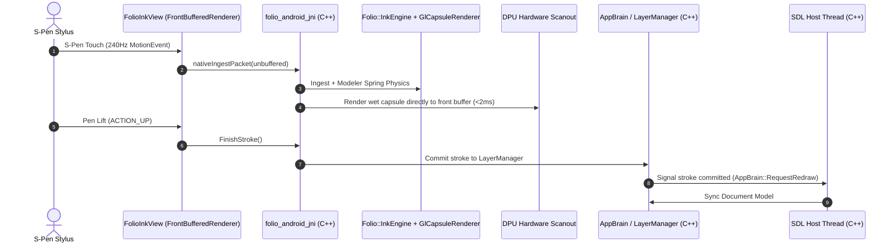

# Android Zero-Latency Inking & Host Architecture Guide

## 1. Executive Summary & Hardware Physics

On modern Android tablets with active digitizers (such as the Samsung Galaxy Tab S9 / S10 series with S-Pen, running OneUI 6+ / Android 14+), the digitizer reports pen events at **240Hz to 480Hz**, and the display refreshes at **120Hz** (8.33ms per frame).

- **Standard Inking (Stock Android / SDL3 Game Loop)**: ~15ms to 35ms latency.
- **SurfaceFlinger Multi-Buffer Bypass**: ~8ms latency.
- **Hardware DPU Direct Scanout (Folio-Sketch Bare Metal Target)**: **<2ms latency ("stuck to the pen tip")**.

Achieving sub-2ms latency is not simply a matter of "optimizing C++ code." It is governed by strict physical constraints of the Android display pipeline, Qualcomm/Exynos Display Processing Units (DPU), and SurfaceFlinger.

---

## 2. Codebase Organization & Directory Structure

```
Folio-Sketch/
├── CMakeLists.txt                      <-- Primary build file; defines 'folio_sketch', 'folio_backends', and 'main'
├── include/folio_sketch/
│   ├── core/
│   │   ├── ink_config.hpp              <-- STRICT CONFIG: Modeler spring-mass physics & Kalman prediction constants
│   │   ├── raw_input.hpp               <-- RawInputSample representation (x, y, pressure, tilt, time)
│   │   └── stroke_point.hpp            <-- Modeled stroke vertices (x, y, r, pressure)
│   └── engine/
│       └── ink_engine.hpp              <-- Core C++ inking pipeline: Modeler + Predictor + Outline Builder
├── folio_backends/
│   ├── CMakeLists.txt                  <-- Builds static lib 'folio_backends' (linked into libmain.so)
│   ├── common/
│   │   ├── gl_capsule_renderer.hpp     <-- GPU Capsule SDF Instanced Renderer API
│   │   └── gl_capsule_renderer.cpp     <-- GLSL shader evaluating analytic capsule SDFs with NDC platform projection
│   └── android/
│       ├── android_frontbuffer.hpp/.cpp<-- Native frontbuffer management wrapper
│       └── folio_android_jni.cpp       <-- JNI entry point: bridges Android MotionEvents directly to C++ engine
├── inspectorV2.0/                      <-- V2.0 Modular Host Architecture (Replaces monolithic inspector V1)
│   ├── app_brain.hpp                   <-- Thread-safe central C++ Singleton connecting SDL host with inking engine
│   ├── layer_manager.hpp/.cpp          <-- Dual-layer orchestrator (live wet bypass + committed document canvas)
│   ├── input_manager.hpp/.cpp          <-- Unified device router & 2-finger gesture/palm rejection state machine
│   ├── ui_manager.hpp                  <-- Embedded Dear ImGui HUD renderer
│   ├── main.cpp                        <-- SDL3 Host entry point (main / SDL_main)
│   └── android/                        <-- Android Gradle Project (relocated from src/android-project)
│       ├── build.gradle
│       ├── settings.gradle
│       └── app/
│           ├── build.gradle            <-- Configures NDK cmake to ../../../CMakeLists.txt (produces libmain.so)
│           └── src/main/
│               ├── AndroidManifest.xml <-- Registers FolioHostActivity and FolioCanvasActivity
│               └── java/
│                   ├── org/libsdl/app/ <-- Restored SDL3 runtime Java classes (SDLActivity, SDLSurface, etc.)
│                   └── org/foliosketch/android/
│                       ├── FolioHostActivity.java   <-- Subclasses SDLActivity; boots SDL thread without 2nd surface
│                       ├── FolioCanvasActivity.java <-- Bare-metal standalone fallback activity
│                       ├── FolioInkView.java        <-- SurfaceView wrapping Jetpack GLFrontBufferedRenderer
│                       └── FolioNativeBridge.java   <-- JNI native methods declaration
└── third_party/
    ├── SDL/                            <-- Vendored SDL3 (static)
    ├── imgui/                          <-- Vendored Dear ImGui (with SDL3 & OpenGL3 backends)
    └── ink-stroke-modeler/             <-- Google Ink Stroke Modeler (spring-mass-damper ODE)
```

---

## 3. The 3 Immutable Laws of Sub-2ms Latency on Android

Through rigorous benchmarking on the Samsung Galaxy Tab `SM-X930`, we have isolated the three absolute requirements for zero-latency scanout:

### Law 1: The Single Hardware Surface Constraint
```
[ App Window ]
      │
      ├── EXACTLY ONE SurfaceView (Hardware Scanout Overlay Bypass)  ==> < 2ms latency
      │
      └── TWO SurfaceViews (e.g., SDLSurface + FolioInkView)
            └── SurfaceFlinger cancels hardware overlay bypass!
            └── BLASTBufferQueue forces multi-buffer GPU composition ==> ~8ms to 15ms latency!
```
The mobile DPU will grant direct unbuffered hardware scanout **if and only if there is exactly one active `SurfaceView` in the window hierarchy**. As soon as a second `SurfaceView` is attached, the hardware compositor revokes direct scanout bypass and forces both through SurfaceFlinger composition queues.

### Law 2: The Swapchain Contention Law (Zero Continuous Swaps During Inking)
Desktop game engines run a continuous loop calling `SDL_GL_SwapWindow` at 120 FPS.
On Android:
- Every `SDL_GL_SwapWindow` or `eglSwapBuffers` queues an EGL buffer swap with SurfaceFlinger.
- The GPU driver enforces fence synchronization on the window.
- If an active swap loop executes while the pen is touching the screen, the unbuffered stylus packets must wait for the GPU to finish the swapchain transition, adding **~8ms of latency**.
- **Rule**: The host loop MUST be **event-driven** (`SDL_WaitEvent`). During active inking, **ZERO** `SDL_GL_SwapWindow` calls may be made.

### Law 3: Digitizer Batch Ingestion (`requestUnbufferedDispatch`)
Android's `InputDispatcher` defaults to batching touch samples to the 60Hz or 120Hz VSYNC tick.
- `requestUnbufferedDispatch(event)` must be called on stylus `ACTION_DOWN` / `ACTION_MOVE`.
- Historical samples (`event.getHistoricalX/Y(...)`) must be drained in chronological order to capture every 240Hz/480Hz sub-frame packet.

---

## 4. Current Working Solution (V2.0 State)

### The Dual-Thread Setup


### How the Components Interact
1. **Host Activity (`FolioHostActivity.java`)**:
   - Subclasses `org.libsdl.app.SDLActivity`.
   - Starts SDL's native thread (`SDL_main`), but does **not** attach SDL's default `mSurface`.
   - Overrides `getInitSubsystems()` to exclude Java-side video allocation:
     ```java
     @Override
     protected int getInitSubsystems() {
         return SDL_INIT_AUDIO | SDL_INIT_JOYSTICK | SDL_INIT_HAPTIC | SDL_INIT_GAMEPAD | SDL_INIT_SENSOR | SDL_INIT_CAMERA;
     }
     ```
     This allows SDL's C++ thread to boot immediately while leaving `FolioInkView` as the **sole** hardware `SurfaceView`.
2. **Scanout Surface (`FolioInkView.java`)**:
   - Uses Android Jetpack's `androidx.graphics.lowlatency.GLFrontBufferedRenderer`.
   - Single `SurfaceView` attached to the window with `setZOrderOnTop(true)` and `PixelFormat.TRANSLUCENT`.
   - Ingests `MotionEvent`s: stylus packets trigger `renderFrontBufferedLayer`; pen lift triggers `commit()`.
3. **C++ JNI Bridge (`folio_android_jni.cpp`)**:
   - Implements `nativeIngestPacket`, `nativeRenderWet`, and `nativeRenderDry`.
   - Directs wet inking to `GlCapsuleRenderer` to draw directly to the front buffer with sub-2ms latency.
   - On stroke finish, commits the modeled points into `AppBrain::Instance().GetLayerManager().AddDocumentStroke(...)`.
4. **C++ Application Brain (`inspectorV2.0/app_brain.hpp`)**:
   - Central singleton owned by C++ and shared between SDL's host thread and the digitizer scanout engine.
   - Synchronizes committed strokes, canvas transforms (pan/zoom), and brush configurations.
5. **SDL Host Thread (`inspectorV2.0/main.cpp`)**:
   - Runs `main()` / `SDL_main`.
   - Monitors `AppBrain::CheckAndResetRedraw()` without executing continuous GPU swaps, preserving the zero-latency bypass.

---

## 5. The Architectural Dilemma: Who Drives the Application?

### The Problem
In the current setup, `FolioInkView` (via Android Jetpack's `GLFrontBufferedRenderer`) drives the frame callbacks:
- `onDrawFrontBufferedLayer`: Renders the live wet stroke under the pen tip (<2ms).
- `onDrawMultiBufferedLayer`: Renders only when a stroke commits on pen lift (`mFrontBufferedRenderer.commit()`).

Because `onDrawMultiBufferedLayer` is an event-driven callback that only fires on pen lift:
- You cannot easily host a dynamic desktop-style GUI (like Dear ImGui with continuous hover effects, sliders, or animations).
- Java is still holding the `GLFrontBufferedRenderer` lifecycle, while SDL's thread is essentially sleeping in the background.

We want **C++ and SDL3 to be the true driver**, but mobile hardware laws forbid a continuous 120 FPS swapchain loop without destroying the <2ms latency.

---

## 6. Architectural Options for Discussion

### Option A: Pure C++ Front-Buffer Hijack (SDL-Native Driver)
- **Concept**: SDL creates the window and surface normally (`ANativeWindow`). In C++, we query `ANativeWindow` from SDL via `SDL_GetPointerProperty(..., SDL_PROP_WINDOW_ANDROID_WINDOW_POINTER)` and configure it directly with unbuffered EGL front-buffer flags (`EGL_RENDER_BUFFER = EGL_SINGLE_BUFFER`).
- **Pros**: 100% C++ driven. Zero Java renderer dependencies. SDL owns the window.
- **Cons**: On OneUI 6 / Android 14, raw `EGL_SINGLE_BUFFER` without Android's private `BLASTBufferQueue` negotiation often fails to get true DPU overlay bypass, regressing to ~8ms or tearing heavily. (This is why Google wrote Jetpack `GLFrontBufferedRenderer`).

### Option B: Layered Dual-Sublayer Architecture (Current Recommended Direction)
- **Concept**: Accept that on Android 14, `GLFrontBufferedRenderer` is the sanctioned OS path to negotiate DPU hardware scanout overlay.
- **Structure**:
  1. `FolioInkView` acts as the single window surface.
  2. The **Front-Buffered sublayer** runs the zero-latency C++ inking engine (<2ms).
  3. The **Multi-Buffered sublayer** acts as the SDL / C++ document & UI canvas.
  4. SDL's host loop is **purely event-driven**:
     - When idle: sleeps (0% CPU / 0% GPU).
     - When pen inks: Front buffer draws wet strokes; SDL does not swap.
     - When UI needs updating or pen lifts: The multi-buffered layer swaps *once* to update ImGui and committed strokes.
- **Pros**: Guaranteed <2ms latency preserved. Full C++ engine controls the document model. ImGui works on demand.
- **Cons**: UI cannot animate at a continuous 120 FPS while the user is actively drawing a stroke with the pen.

### Option C: Off-Screen ImGui Compositor with Invalidation Triggers
- **Concept**: SDL runs in C++, rendering ImGui and the document canvas into an off-screen texture (FBO) only when dirty (user touches a button, drags a slider, or lifts the pen). That texture is blitted during the multi-buffered pass.
- **Pros**: Clean separation. ImGui interaction doesn't interfere with the 240Hz digitizer thread.
- **Cons**: Requires touch routing to feed both ImGui hit-testing and stylus inking.

---

## 7. Coordinate System Reference

### OpenGL NDC vs. Screen Space
- Screen space: `(0, 0)` is top-left, `(width, height)` is bottom-right.
- Standard OpenGL NDC: `(-1.0, -1.0)` is bottom-left, `(+1.0, +1.0)` is top-right.
- **Android Front-Buffer Scanout vs Desktop Linux**:
  Android's hardware front-buffer scanout applies an internal panel orientation inversion. To ensure correct tracking across both platforms, `gl_capsule_renderer.cpp` uses platform-conditional NDC projection:
  ```glsl
  vec2 screenPos = worldPos * zoom + uTransform.xy;
  #if defined(__ANDROID__)
      vec2 ndc = vec2(
          (screenPos.x / uViewport.x) * 2.0 - 1.0,
          (screenPos.y / uViewport.y) * 2.0 - 1.0
      );
  #else
      vec2 ndc = vec2(
          (screenPos.x / uViewport.x) * 2.0 - 1.0,
          1.0 - (screenPos.y / uViewport.y) * 2.0
      );
  #endif
  gl_Position = vec4(ndc, 0.0, 1.0);
  ```

---

## 8. Open Questions for Peer Review & Architecture Discussion

1. **How should Dear ImGui be driven on Android?**
   Should ImGui render on-demand via `GLFrontBufferedRenderer`'s multi-buffered pass, or should we decouple ImGui into a separate invalidation-driven compositor pass?
2. **Can SDL3 directly host `GLFrontBufferedRenderer` via JNI/C++ bindings**, eliminating the need for `FolioInkView.java` to act as anything more than a dummy container?
3. **What is the cleanest way to route multi-touch gestures (two-finger pan/zoom) back into SDL's event queue** while keeping the 240Hz stylus on the zero-latency bypass?
