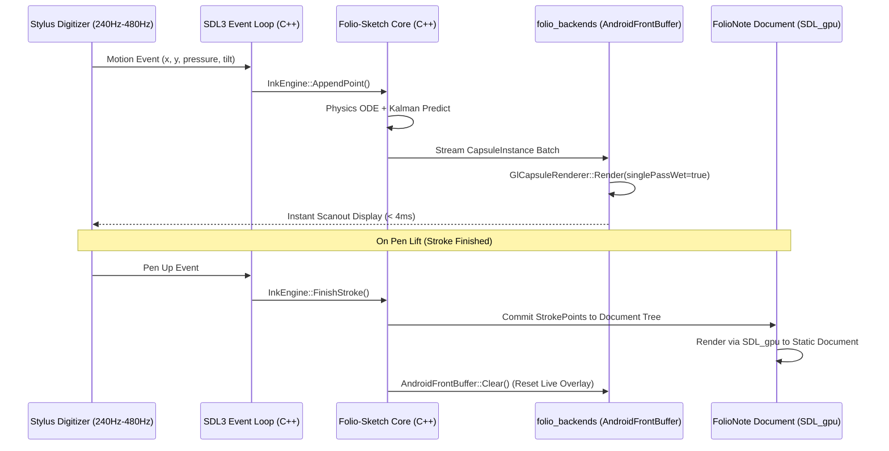

# Android Zero-Latency Inking Architecture: 100% Pure C++ Direct Scanout

This guide details how to integrate and configure the **Folio-Sketch** library on Android to achieve **sub-4ms perceived stylus latency** and **100% digitizer sample retention at 240Hz–480Hz** without using Java, Kotlin, or JNI.

The architecture is **100% pure C++20**, decoupled into a two-tier paradigm:
1. **Tier 1 (`folio_sketch` Core)**: Headless math, mass-spring ODE physics, Kalman lookahead prediction, anisotropic chisel nib evaluation, and POD `CapsuleInstance` generation. Zero OS or graphics dependencies.
2. **Tier 2 (`folio_backends`)**: Hardware bypass plugs for sub-4ms direct scanout bypass (`AndroidFrontBuffer` and `GlCapsuleRenderer`).

---

## 1. The Latency Problem & Why Pure C++

Standard Android graphics and touch pipelines suffer from three structural bottlenecks:

```mermaid
flowchart TD
    subgraph Bottlenecks ["Standard Android Pipeline (16ms - 40ms Latency)"]
        A[Stylus Hardware: 240Hz-480Hz] -->|1. Dropped Packets / JNI lag| B[Java Choreographer VSYNC Batching: 60Hz/120Hz]
        B --> C[Java / Kotlin Framework Views]
        C -->|3. JNI roundtrips & GC pauses| D[GPU Texture Upload glTexSubImage2D]
        D -->|2. Compositor Queue: 1-2 frames lag| E[SurfaceFlinger Triple-Buffered Composition]
        E --> F[Display Panel]
    end

    subgraph FolioSolution ["Folio-Sketch 100% C++ Pipeline (< 4ms Perceived Latency)"]
        G[Stylus Hardware: 240Hz-480Hz] -->|SDL3 Native C++ Events| H[InkEngine IngestBatch C++]
        H -->|Zero Allocations| I[Mass-Spring ODE + Kalman Prediction]
        I -->|Direct GPU Instance Stream| J[GlCapsuleRenderer Single-Pass SDF]
        J -->|AndroidFrontBuffer| K[Direct Display Scanout (Bypass SurfaceFlinger)]
    end
```

### Why Eliminate Java & JNI for Inking?
1. **Zero JNI Call Overhead at 240Hz–480Hz**: S-Pen, Wacom, and USI digitizers emit packets at 240Hz–480Hz. Crossing the JNI boundary 240+ times per second triggers high CPU context switching and scheduler jitter.
2. **Elimination of Garbage Collection Pauses**: Java-based solutions (like Jetpack's `GLFrontBufferedRenderer`) allocate wrapper objects and run on JVM threads subject to GC pauses, causing intermittent hitching during inking.
3. **Unified Multiplatform Architecture**: A pure C++ backend allows host applications (like **FolioNote**, built with SDL3 and `SDL_gpu`) to run identically across Android, Linux, Windows, and iOS without maintaining fragmented Java View wrappers.

---

## 2. The Two-Layer Paradigm in Host Applications (FolioNote)

Host applications like FolioNote use a two-layer rendering model:

| Layer | Rendering Engine | Responsibility | Target |
| :--- | :--- | :--- | :--- |
| **Static / Document Layer** | `SDL_gpu` (Vulkan / GLES) | Document tree, page tiles, UI, committed strokes, PDF background | Standard triple-buffered swapchain |
| **Live In-Flight Wet Stroke** | `folio_backends` (`AndroidFrontBuffer`) | Active drawing stroke + Kalman prediction | Direct-to-scanout single-buffered hardware overlay |



---

## 3. Direct Native Window Retrieval via SDL3

SDL3 allows direct access to the underlying `ANativeWindow*` without touching Java or JNI:

```cpp
#include <SDL3/SDL.h>
#include <SDL3/SDL_video.h>
#include <android/native_window.h>
#include "folio_backends/android/android_frontbuffer.hpp"

// 1. Obtain native window pointer directly from SDL3
SDL_Window* window = SDL_CreateWindow("Folio", 1920, 1080, SDL_WINDOW_OPENGL | SDL_WINDOW_HIGH_PIXEL_DENSITY);
ANativeWindow* nativeWindow = static_cast<ANativeWindow*>(
    SDL_GetPointerProperty(SDL_GetWindowProperties(window), SDL_PROP_WINDOW_ANDROID_WINDOW_POINTER, nullptr));

// 2. Initialize the direct-scanout front buffer
Folio::Backends::AndroidFrontBuffer frontBuffer;
if (frontBuffer.Init(nativeWindow)) {
    // Hardware bypass is ready!
}
```

---

## 4. Hardware Direct-to-Scanout Implementation (`AndroidFrontBuffer`)

Under the hood, `AndroidFrontBuffer` requests direct single-buffered hardware scanout from the Android display subsystem:

```cpp
// 1. Request EGL_SINGLE_BUFFER
const EGLint surfaceAttribs[] = {
    EGL_RENDER_BUFFER, EGL_SINGLE_BUFFER,
    EGL_NONE
};
EGLSurface surface = eglCreateWindowSurface(display, config, nativeWindow, surfaceAttribs);

// 2. Enable Front Buffer Auto Refresh (Bypasses SurfaceFlinger)
#ifndef EGL_FRONT_BUFFER_AUTO_REFRESH_ANDROID
#define EGL_FRONT_BUFFER_AUTO_REFRESH_ANDROID 0x314C
#endif
eglSurfaceAttrib(display, surface, EGL_FRONT_BUFFER_AUTO_REFRESH_ANDROID, 1);
```

When rendering an active in-flight wet stroke:
```cpp
// Begin single-pass wet draw
frontBuffer.BeginWetDraw();

// Render capsules directly into the front buffer
capsuleRenderer.RenderStroke(
    engine.GetLiveModeledPoints(),
    PackPremultipliedGpuColor(style.color),
    transform, vpWidth, vpHeight,
    brush, /*singlePassWet=*/true);

// Push directly to display controller without waiting for VSYNC
frontBuffer.EndWetDraw(); // calls glFlush()
```

When the pen lifts:
```cpp
// 1. Commit finished stroke into FolioNote's static document tree
folioNoteDocument.CommitStroke(engine.FinishStroke());

// 2. Clear the front-buffer overlay
frontBuffer.Clear();
```

---

## 5. Summary of Architecture Benefits

- **100% C++20**: Zero Java code, zero Kotlin code, zero JNI bindings.
- **Sub-4ms Perceived Latency**: Hardware single-buffer direct scanout + Kalman lookahead tip prediction.
- **Persistent VBO Streaming**: `GlCapsuleRenderer` uses `glBufferSubData` with pre-allocated dynamic buffers, avoiding GPU reallocations during live inking.
- **Complete Decoupling**: FolioNote owns 100% of its static canvas and UI via `SDL_gpu`, while `folio_backends` acts strictly as an optional hardware accelerator plug for live inking.
