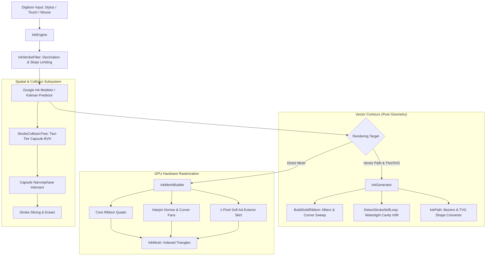

# Architecture Overview

**Folio-Sketch** is a modular, high-performance C++20 vector inking and geometric processing engine. It is partitioned into clear functional layers with strict boundary separation between **raw hardware input handling**, **predictive modeling**, **pure computational geometry & vector path generation**, **direct GPU mesh tessellation**, and **spatial collision queries**.

---

## 1. Subsystem Directory Breakdown

| Directory | Responsibilities | Key Components |
| :--- | :--- | :--- |
| [`include/folio_sketch/`](../include/folio_sketch/) | Public headers and core API facade | [`ink_engine.hpp`](../include/folio_sketch/ink_engine.hpp), [`ink_generator.hpp`](../include/folio_sketch/ink_generator.hpp), [`ink_mesh.hpp`](../include/folio_sketch/ink_mesh.hpp), [`ink_config.hpp`](../include/folio_sketch/ink_config.hpp), [`ink_stroke_data.hpp`](../include/folio_sketch/ink_stroke_data.hpp) |
| [`src/engine/`](../src/engine/) | Inking engine lifecycle, live point accumulation, physics updates, pen-up finalization | [`ink_engine.cpp`](../src/engine/ink_engine.cpp) |
| [`src/geometry/`](../src/geometry/) | Mathematical primitives, segment evaluation, 2D intersection algebra, nib profiles, point decimation | [`ink_geometry_utils.cpp`](../src/geometry/ink_geometry_utils.cpp), [`ink_stroke_filter.cpp`](../src/geometry/ink_stroke_filter.cpp), [`ink_nib_geometry.hpp`](../src/geometry/ink_nib_geometry.hpp) |
| [`src/generator/`](../src/generator/) | Vector contour generation, bisector miter computation, corner fillet fans, loop infill extraction | [`ink_generator_ribbon.cpp`](../src/generator/ink_generator_ribbon.cpp), [`ink_ribbon_corner.cpp`](../src/generator/ink_ribbon_corner.cpp), [`ink_generator_infill.cpp`](../src/generator/ink_generator_infill.cpp), [`ink_generator_caps.cpp`](../src/generator/ink_generator_caps.cpp) |
| [`src/mesh/`](../src/mesh/) | Direct GPU triangle strip and index generation with dual-buffer anti-aliasing skirts | [`ink_mesh_builder.cpp`](../src/mesh/ink_mesh_builder.cpp) |

---

## 2. Inking Lifecycle Pipeline

1. **Input Phase (`InkEngine::AddPoint`)**:
   - Stylus reports `(x, y, pressure, tiltX, tiltY, timestamp)`.
   - Incoming coordinates pass through `InkStrokeFilter::DecimatePoints` to reject sub-pixel jitter ($< 0.05\text{ mm}$).
   - `InkStrokeFilter::EnforceSlopeLimit` enforces Lipschitz continuity to prevent unrealistic step-function spikes in stylus pressure.

2. **Modeling & Prediction Phase**:
   - Points are passed to the physical modeler (`InkModeler` or internal spring-mass physics).
   - Kalman filter predicts 1–3 forward points along the instantaneous motion vector to compensate for OS display latency (~16–30 ms).

3. **Geometry Generation Phase**:
   - **Vector Generation (`InkGenerator`)**: Builds continuous 2D boundary polygons (`InkPath`) containing cubic Béziers, round endcaps, and corner fillets. Clean rails are verified via `PruneSwallowtailLoops` to eliminate interior pinch loops.
   - **GPU Mesh Generation (`InkMeshBuilder`)**: Builds indexed triangle strips (`InkMesh`) partitioned into core geometry (`coreIndices`) and soft exterior anti-aliasing boundary skirts (`skirtIndices`).

4. **Pen-Up Finalization (`InkEngine::PenUp`)**:
   - Flushes remaining physics springs.
   - Generates the final high-precision stroke contours.
   - Dispatches closed loop tests (`DetectStrokeSelfLoop`) if vector flood infill is requested.

---

## 3. Detailed Component Documentation

For comprehensive mathematical derivations, algorithm steps, and API details:
* [**Geometry & Intersection Mathematics**](geometry.md)
* [**Vector Ribbon & Infill Generator**](vector_generator.md)
* [**GPU Mesh Builder & Anti-Aliasing Skirts**](mesh_builder.md)
