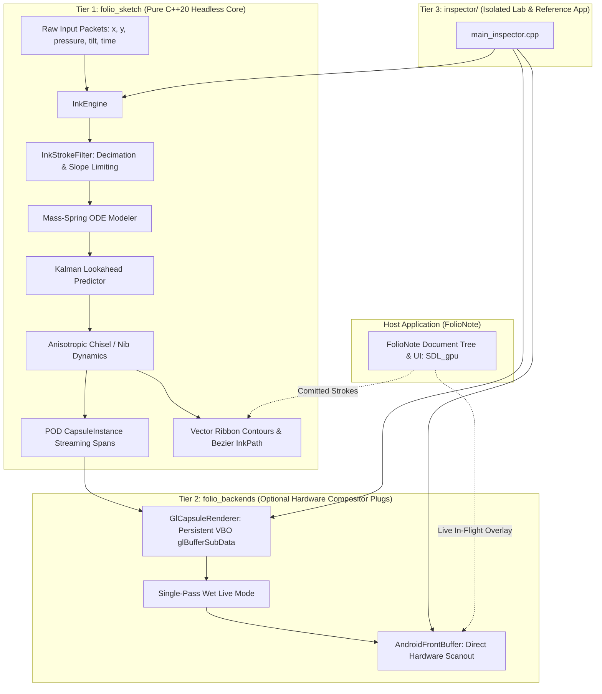

# Architecture Overview: Two-Tier Decoupled Design

**Folio-Sketch** is a modular, high-performance C++20 vector inking and geometric processing engine. It is strictly partitioned into a two-tier architecture plus an isolated diagnostics and reference playground:

---

## 1. The Three Tiers

### Tier 1: `folio_sketch` Core (Headless C++20 Library)
- **Zero OS / Graphics Dependencies**: No OpenGL, GLES, Vulkan, Android NDK, or SDL headers in `include/folio_sketch/`.
- **Pure Mathematics & Geometry**: Mass-spring ODE smoothing, Kalman tip lookahead prediction with distance-attenuated alpha fading, anisotropic calligraphy/chisel nib angle evaluation.
- **Data Generation**: Generates 32-byte trivially copyable POD `CapsuleInstance` spans for GPU rasterizers and continuous cubic Bézier `InkPath` vector ribbons for static storage.

### Tier 2: `folio_backends` (Optional Hardware Plugs)
- **Low-Latency Compositor Bypass**: Plugs into native OS display subsystems to achieve sub-4ms perceived inking latency by bypassing the OS window compositor (e.g. SurfaceFlinger on Android, DWM on Windows, Wayland on Linux).
- **100% Pure C++**: Zero Java or Kotlin code, zero JNI bindings. Uses `ANativeWindow` and `EGL_FRONT_BUFFER_AUTO_REFRESH_ANDROID` on Android.
- **GlCapsuleRenderer**: Standalone GLES 3.0 / GL 3.3 instanced Euclidean SDF quad renderer with persistent dynamic VBO streaming (`glBufferSubData`) and single-pass live wet stroke mode.

### Tier 3: `inspector/` (Diagnostic Playground & Living Reference)
- Isolated diagnostic tool and interactive playground (moved from `src/debug/`).
- Exercises raw sensor telemetry, modeler curves, nib geometry, RDP post-processing simplification, hold-to-snap shapes, and front-buffer wet/dry presentation.

---

## 2. Host Application Integration (FolioNote)

Host applications like **FolioNote** use a two-layer rendering model:
1. **Static Document Canvas & UI**: Rendered via `SDL_gpu` (Vulkan/Metal/GLES) through the standard double/triple-buffered presentation swapchain.
2. **Live In-Flight Wet Stroke**: Rendered via `folio_backends` (`AndroidFrontBuffer`) directly to the front scanout buffer, bypassing the compositor queue.
3. **On Pen Lift**: The stroke commits into FolioNote's static document tree, and the live overlay is cleared with `AndroidFrontBuffer::Clear()`.

---

## 3. Directory Breakdown

| Directory | Layer | Description |
| :--- | :--- | :--- |
| [`include/folio_sketch/`](../include/folio_sketch/) | Core Public API | Headless C++20 API (`ink_engine.hpp`, `raw_input.hpp`, `ink_mesh.hpp`, etc.). |
| [`src/`](../src/) | Core Implementation | Pure C++20 math, geometry, and mesh building (`engine/`, `geometry/`, `gpu/`, `mesh/`, `vector/`). |
| [`folio_backends/`](../folio_backends/) | Hardware Plugs | Hardware bypass backends (`common/gl_capsule_renderer`, `android/android_frontbuffer`). |
| [`inspector/`](../inspector/) | Reference Playground | Standalone interactive inspector and testbench. |
